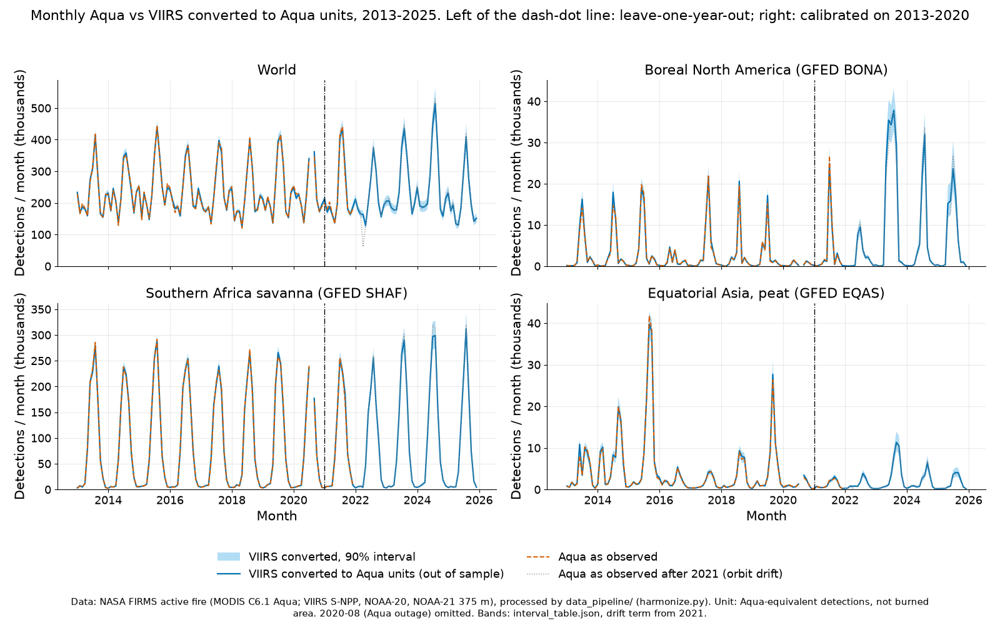
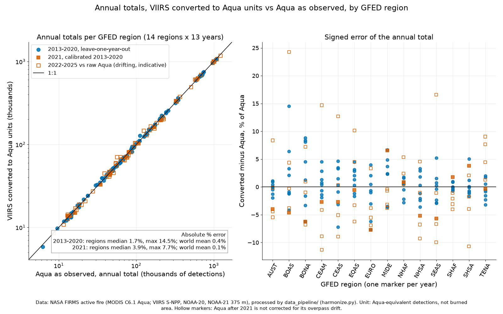
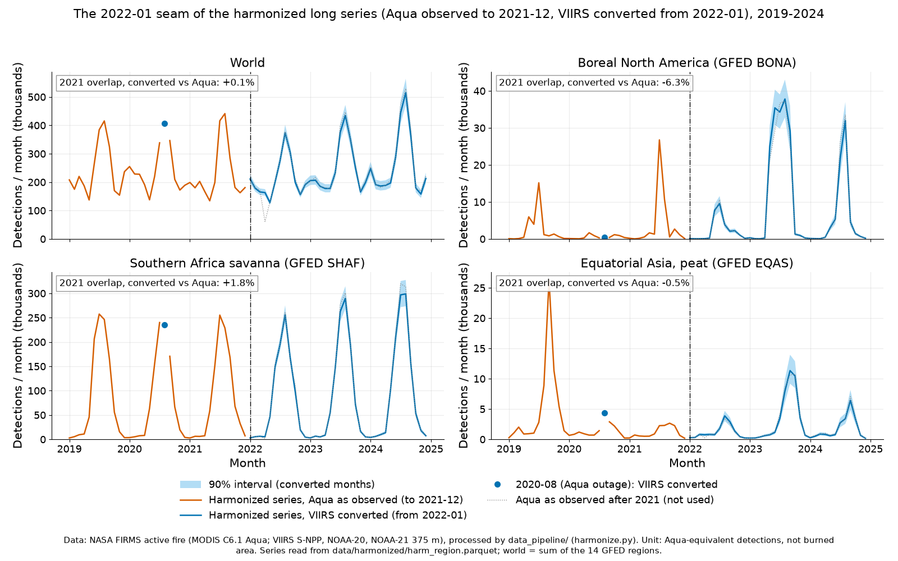
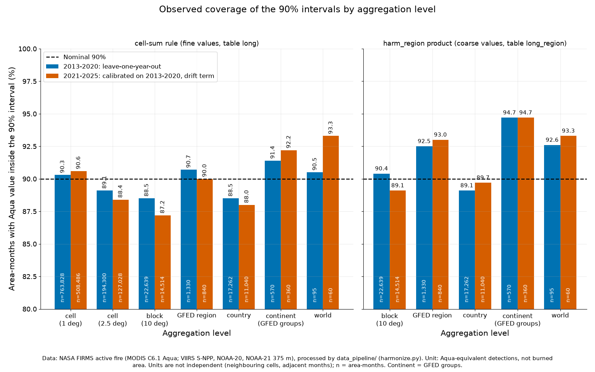

# MODIS / VIIRS harmonization

Frozen method, 2026-11-14. Code: `harmonize.py`. Outputs: `data/harmonized/`.

## What it produces

| File | Content |
|---|---|
| `harm_map.parquet` | Cell product (1 deg x month), fine method. Columns: `series`, `month`, `cell_lat`, `cell_lon` (cell centre), `value` (day + night), `value_day`, `value_night`, `origin`, `partial`. Only cells with value > 0. |
| `harm_region.parquet` | Regional product (month), coarse method. Columns: `series`, `region_type` (`gfed`, `country`, `block10`), `region_id`, `month`, `value`, `lo90`, `hi90`, `origin`. |
| `interval_table.json` | How to put a 90% interval on the monthly total of any area (sum of `harm_map` cells). The rule is written inside the file. |
| `coefficients.parquet` | The frozen coefficients used by `apply`. |

Two series, one unit each:

- **`long`**: Aqua-equivalent active-fire detections (MODIS 1 km pixel, day + night), from **2003-01**. `origin = aqua_obs` until 2021-12 (Aqua as observed); `origin = viirs_conv` from 2022-01 (VIIRS converted to Aqua units), and in 2020-08 (Aqua outage).
- **`detail`**: VIIRS 375 m detections, from **2013-01**, at S-NPP level, harmonized only among S-NPP, NOAA-20 and NOAA-21 (`origin = viirs_native`). Nothing is invented before 2012.

The unit is a count of fire detections per cell and month, not burned area.

## Method in ten lines

1. The FIRMS `type` field is ignored (MODIS reclassified many agricultural fires as static sources from the 2018 archive version). Static sources are masked with one rule for every sensor: 0.1 deg cells where more than 50% of S-NPP detections in 2013-2025 are volcano, static or offshore (8,015 cells).
2. VIIRS detections of the same overpass falling in one ~1 km ground cell form one cluster; each cluster counts `F^2 / (F^2 + 10^2)`, with `F` the summed FRP in MW. This mimics what a 1 km MODIS pixel detects.
3. The daily VIIRS value is the mean of the satellites that are not in outage that day (a satellite is out when its world daily total is below half of the best other one). Satellites: S-NPP (ended 2026-11-02), NOAA-20, NOAA-21.
4. NOAA-21 reads about 9% higher than NOAA-20 with this weighting; its level factor is NOAA-20 / NOAA-21 over the 12 months before, by latitude band and day/night. In nightly runs the last fitted factor is carried forward.
5. VIIRS to Aqua units: ratio Aqua / predictor per 2.5 deg block x calendar month x day/night, shrunk in log space toward the latitude band (weight V / (V + 20)), then a 1 deg cell term (weight V / (V + 1000)). This is the fine method (`harm_map`). The coarse method (`harm_region`) uses 10 deg blocks.
6. Calibration: S-NPP against Aqua, 2013-2020 (2020-08 excluded), before Aqua's orbit started to drift. Nothing is recalibrated after 2020.
7. `long` = Aqua observed to 2021-12, converted VIIRS afterwards. `detail` = VIIRS native.
8. Intervals: 5% and 95% quantiles of observed / predicted by level of the monthly total, from out-of-sample residuals (each year of 2013-2020 predicted from the other seven). For converted months a drift term grows with the years after 2020 (taken from the Terra-Aqua pair, 2003-2020).
9. Aqua observed months carry no interval (`lo90 = hi90 = value`). For `detail` the table gives only the spread between satellite pairs, not an error against a reference.
10. `apply` uses only `coefficients.parquet`, `interval_table.json` and the parquet files present in `data/parquet`; it needs no historical archive.

## How well it works (out of sample, 2013-2025 chain)

Leave-one-year-out 2013-2020 / calibrated on 2013-2020 and tested on 2021-2025, against Aqua:

- median monthly error per 1 deg cell (median |ln((obs+1)/(pred+1))|): 0.241 / 0.241; 86% / 85% within a factor of 2;
- annual totals per cell: 11% / 14% (1 deg), 9% / 12% (2.5 deg); per GFED region: 2% / 5%; world: 1% / 3%;
- step at the 2022-01 seam, world: below 1% against Aqua;
- trends per country against the single-sensor record (stress variant, VIIRS converted from 2013): same sign in 89-90% of 136 countries, rank correlation 0.94;
- 90% intervals, out-of-sample coverage with the drift term, 2013-2020 / 2021-2025: 1 deg cell 90.3% / 90.6%; 2.5 deg cell 89.1% / 88.5%; 10 deg block 88.4% / 87.5%; GFED region 89.6% / 89.9%; country 88.4% / 88.6%; continent 89.8% / 91.3%; world 90.5% / 93.2%.

## Limits to declare

- **Aqua-equivalent compresses small fires.** Clusters under 10 MW are two thirds of the clusters VIIRS sees but about a third of the weight in the `long` series (up to 78% against 41% in South-East Asia, Middle East, Europe, Central Asia). Monthly anomalies and country trends barely change (correlation 0.96-0.99 in most regions), but regional trends can differ in sign (Middle East, Europe). The `detail` series keeps them.
- **Before 2003** there is no harmonized series. Terra alone flew from 2000-11 to 2002-06 and its conversion is not verifiable.
- **Aqua drifts after 2021** (overpass 13:36 to about 15:30 by 2026). The product does not use Aqua after 2021. Checks after 2021 use an Aqua corrected for the overpass shift, which is partly circular (VIIRS is the stable witness).
- **The drift term in the intervals is an assumption** (Terra-Aqua behaviour), not a measurement of VIIRS drift.
- **2026 data** are partly near-real-time and can be revised. The month in progress is flagged `partial`. From 2026-11 only NOAA-20 and NOAA-21 fly (S-NPP ended 2026-11-02). The expected step at that seam is +0.09% worldwide (from the 12 common months), but the measured step rests on 11 days of data and should be recomputed once two or three months are available.
- **Cell level is noisy.** Cells with few detections per month have wide intervals (a factor of about 4 between lower and upper bound). Use regional totals for statements.
- **FRP** is not harmonized. Counts only.

## How to regenerate

Requirements: `duckdb`, `numpy`, `pandas`, `pyarrow` (`requirements-harmonize.txt`).

```bash
# once, locally, needs the full archive in data/parquet (about 1 minute)
python harmonize.py fit

# nightly (about 10 seconds on 2026 data only; about 1 minute on the full history)
python harmonize.py apply --from 2026-11
```

`apply --from YYYY-MM` rewrites `harm_map.parquet` and `harm_region.parquet` from that month on and keeps earlier months untouched, but only if those files already exist: on a fresh checkout it writes only the months from `--from` on, so history must be merged by the caller. Run it with `--from 2003-01` (needs the full archive) to rebuild everything.

`apply` stops with exit code 1 when the data in `data/parquet` do not cover the first days of the first month, because that month would silently be understated (monthly totals, level factors and outage detection need whole days). `--allow-partial` overrides the check with a warning.

## Validation figures

Public, re-runnable exhibit of the out-of-sample numbers above. Out of sample means: 2013-2020 leave-one-year-out (the calibration is refitted without the year being tested), 2021-2025 with the frozen coefficients (calibrated on 2013-2020). Reference: Aqua as observed. The script recomputes the S-NPP/Aqua calibration table and the monthly VIIRS predictor from the FIRMS archive, imports the helpers of `harmonize.py` (not modified), and checks itself against the frozen files (recomputed `r_glob` and number of `r_cell` rows equal `coefficients.parquet`; recomputed 2022-2025 GFED values equal `harm_region.parquet`, max relative difference 1e-5).

```bash
pip install -r data_pipeline/validation/requirements.txt    # matplotlib (the pipeline needs duckdb numpy pandas pyarrow)
python data_pipeline/validation/make_validation.py          # about 90 seconds on 16 cores; --reuse skips the heavy step (10 s)
```

Inputs: `data/parquet` (FIRMS archive normalized by `firms_pipeline.py`, all four sensors, 2013-2025), `data/harmonized/coefficients.parquet`, `interval_table.json`, `harm_region.parquet`. Outputs in `docs/validation/`: four PNG figures, `monthly_series.csv`, `error_summary.csv`, `interval_coverage.csv`, `validation_numbers.json`.

**1. Monthly series, world and three fire regimes (boreal, savanna, peat), with the 90% band**



**2. Annual totals per GFED region, converted vs Aqua**



**3. The 2022-01 seam of the long series (2019-2024)**



**4. Observed coverage of the 90% intervals by aggregation level**



Recomputed numbers (`error_summary.csv`, `interval_coverage.csv`):

- Median monthly error per 1 deg cell, 2013-2020 / 2021-2025: 0.240 / 0.236 (table above: 0.241 / 0.241); within a factor of 2: 84.9% / 84.6% (table: 86% / 85%).
- Annual totals, median absolute error, 2013-2020 / 2021-2025: 1 deg cell 11.1% / 13.4% and 2.5 deg cell 8.6% / 11.8% (cell-years with at least 20 Aqua detections in the year; the filter used for the table above is not recorded); GFED region 1.7% / 4.3% (maximum 14.5% / 24.3%); world 0.4% / 1.9% mean, maximum 1.1% / 3.1%.
- Seam, 2021 (last full overlap year, converted with coefficients calibrated on 2013-2020): world +0.1% against Aqua; BONA -6.3%, SHAF +1.8%, EQAS -0.5%.
- Interval coverage by the rule in `interval_table.json` (sum of cells, table `long`), 2013-2020 / 2021-2025: 1 deg cell 90.3% / 90.6%; 2.5 deg 89.1% / 88.4%; 10 deg block 88.5% / 87.2%; GFED region 90.7% / 90.0%; country 88.5% / 88.0%; world 90.5% / 93.3%.
- The intervals published in `harm_region.parquet` (coarse values, table `long_region`) are wider and over-cover: GFED region 92.5% / 93.0%, country 89.1% / 89.7%, world 92.6% / 93.3%.

Caveats:

- After 2021 the comparison is partly circular and not clean. Aqua as observed drifts in overpass time (the grey dotted line in figures 1 and 3, hollow markers in figure 2); the exhibit does not correct it, so the 2022-2025 scatter is indicative only and the 2021-2025 errors above include that drift. The checks quoted at the top of this file for 2021-2025 use an Aqua corrected for the overpass shift, which the public pipeline does not contain.
- Interval coverage is measured on area-months that are not independent (neighbouring cells, adjacent months); the world level rests on 95 and 60 months. The quantiles of the table were built from the same 2013-2020 leave-one-year-out residuals, so 2013-2020 coverage is not an independent test; 2021-2025 is, and it uses the drift term, which is an assumption.
- Continents in the coverage figure are groups of GFED regions (North America including Central America, South America, Africa, Europe, Asia including the Middle East, Oceania), not a country-to-continent table.
- The 2026 months are not shown: they are extrapolated (partly near-real-time, S-NPP ended 2026-11-02) and have no out-of-sample reference.
- Not reproduced here: the per-country trend test (stress variant not available in `harmonize.py`).
- GFED5 burned area is not used as validation. During development the annual totals of a variant record (Aqua to 2012, VIIRS converted after) correlated with GFED5 at 0.93 over 2003-2020, but the published `long` series is almost only Aqua as observed in 2003-2020, so that number would compare Aqua with GFED5, not test the harmonization; it is left out of the results.
